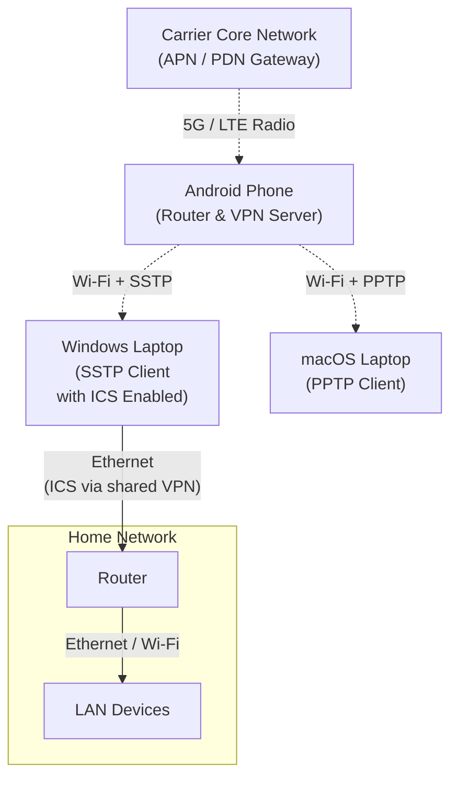
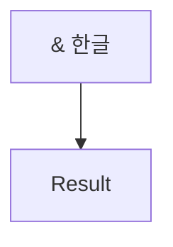

<section data-native-mdx-wrapper>

# Native article structure

한글 문단입니다. English text stays intact. `Stream<? extends Arguments> provideArguments(ExtensionContext context)`를 구현합니다.

## Code

```js
const message = "<tag>& 한글";
const indentation = "  keep  spaces";

```

## Table

| 분류 | 긴 값 |
| --- | --- |
| Markdown | long-value-long-value-long-value-long-value-long-value-long-value-long-value-long-value-long-value-long-value-long-value-long-value- |

## Diagram





</section>
